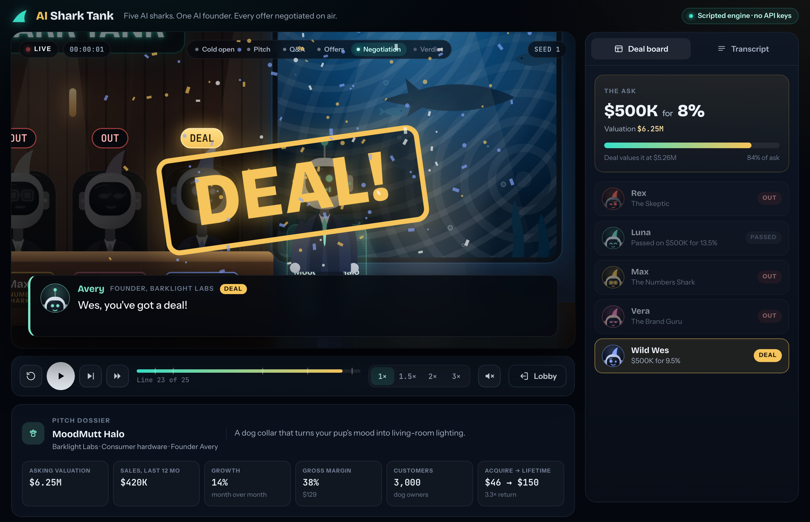
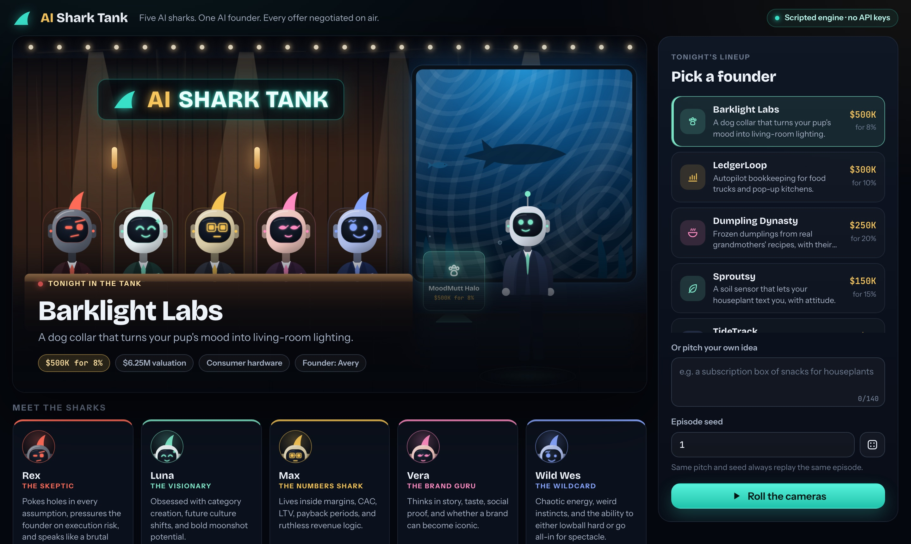
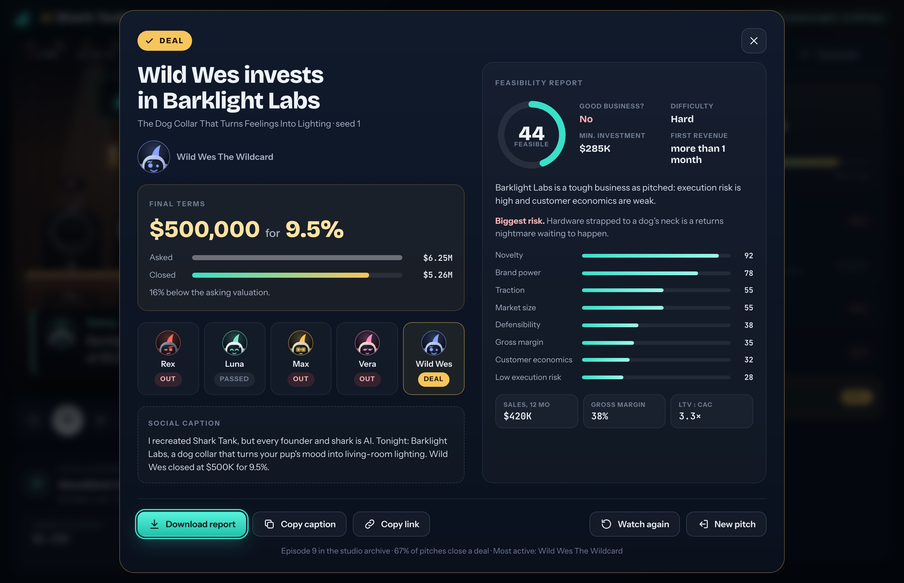

# AI Shark Tank

<p align="center">
  
</p>

`AI Shark Tank` is a browser-based Shark Tank simulator: five AI shark personas, one AI founder, and every question, offer, counter, and handshake played out on a broadcast-style stage. It's built for screenshots, short videos, and social-ready demos.

Right now every episode comes from a **deterministic scripted engine**. There are no API keys and no model calls. The same pitch and seed always produce the same episode, so you can test, record, and share exact takes. A live model provider can plug in later without touching the UI (see [Connecting a live model later](#connecting-a-live-model-later)).

## Demo

[Demo](https://x.com/diegocabezas01/status/2036499979934572573?s=20)

## Quick start

```bash
npm install
npm start
```

Open [http://127.0.0.1:5050](http://127.0.0.1:5050). No `.env` is needed.

## How it works

<p align="center">
  
  
</p>

1. **Pick a founder.** Six hand-written pitches (pet hardware, food-truck SaaS, frozen dumplings, a sassy plant sensor, ocean-plastic buoys, a mismatched-sock club), or type your own idea and the engine builds a company around it.
2. **Pick a seed.** Same pitch + seed = same episode. A different seed is an alternate take: different questions, a different shark mood, sometimes a different deal.
3. **Roll the cameras.** The show runs through six phases:
   - **Cold open** and the founder's entrance
   - **Pitch**: the ask, the problem, the product, the proof
   - **Q&A**: each shark asks one question, aimed at the weakest metric they care about
   - **Offers**: each shark scores the pitch on eight business factors (traction, margin, customer economics, defensibility, novelty, market size, brand, execution risk) through their own persona weights. Above their threshold they make an offer, and the less excited they are, the more equity they want. The least interested go out first.
   - **Negotiation**: with several offers the founder either starts a bidding war or asks two sharks to team up. Then the founder counters, and the shark accepts, meets in the middle, or holds firm. The founder walks if the terms pass their walk-away point.
   - **Verdict**: deal or no deal, plus a feasibility report
4. **Watch it play.** A typewriter caption, camera push-ins on whoever is talking, a spotlight, live offer badges over each shark, and a deal board that tracks every offer against the asking valuation. Use the transcript tab to read back.
5. **Take it with you.** Download the feasibility report as Markdown (with the full transcript), copy the social caption, or copy a share link.

### Controls

| Key | Action |
| --- | --- |
| `Space` | Play / pause |
| `→` | Next line |
| `Shift` + `→` | Skip to the verdict |
| `R` | Restart the episode |

Speeds go from 1× to 3×. The voice toggle reads lines aloud with your browser's built-in speech synthesis, so it still makes no network calls.

### Share links

```
/?pitch=ledgerloop&seed=7               preselect a pitch and seed
/?idea=a+robot+that+folds+laundry       preselect a custom idea
&autoplay=1                             start immediately
&speed=2                                any playback speed from 0.25 to 40
```

## Episode format

`POST /api/episodes` with `{ "pitchId": "barklight", "seed": 1 }` (or `{ "idea": "...", "seed": 1 }`) returns `{ episode, download, allTime }`. The episode is a self-contained script:

| Field | What it holds |
| --- | --- |
| `pitch` | Startup, product, tagline, ask, equity, implied valuation, metrics, founder look |
| `sharks` | The five personas (display fields only; scoring weights stay on the server) |
| `phases` | The six phases, in order |
| `beats[]` | Every line: `speakerId`, `kind`, `phase`, `text`, `targetId`, `tone`, and `effects` |
| `beats[].effects` | Deal-board changes the line causes: `offer`, `out`, `team`, `revise`, `counter`, `deal`, `no_deal` |
| `result` | Outcome, investors, final offer, valuation versus the ask |
| `report` | Feasibility %, good business yes/no, minimum investment, difficulty, time to first revenue, factor scores |

`src/shared/board.js` is a pure reducer over those effects. The browser uses it to render the deal board, and the engine replays every episode through it (`assertEpisodeConsistency`) so the script and the result can never disagree.

Other endpoints: `GET /api/config` (sharks, lineup, phases, limits), `GET /api/health`, and `POST /api/feasibility-report` (score any pitch text).

## Connecting a live model later

All episode generation goes through `src/lib/providers/index.js`. To add a model-backed provider:

1. Implement `{ id, label, live: true, async createEpisode({ pitchId, idea, seed }) }` and return the same episode shape.
2. Run the result through `assertEpisodeConsistency` so its effects add up to its result.
3. Select it in `getEpisodeProvider()`, for example from an environment variable, and put the key in a local `.env` that stays out of git.

The browser, deal board, verdict, and report work unchanged. The previous OpenAI Agents SDK engine and Three.js stage are in git history (commit `a75b7a5`) if you want to reuse any of it.

## Project structure

```
server.js                      Express app: static files, /shared modules, /api routes
src/lib/scriptedEngine.js      Deterministic episode engine (Q&A, offers, negotiation, verdict)
src/lib/scoring.js             Metrics -> business factors -> per-shark interest scores
src/lib/pitchCatalog.js        The six lineup pitches
src/lib/ideaPitch.js           Free-text idea -> structured pitch (seeded)
src/lib/feasibility.js         Feasibility report and Markdown download
src/lib/sharkProfiles.js       Shark personas, weights, thresholds, looks
src/lib/rng.js                 Seeded PRNG (cyrb53 + mulberry32)
src/lib/providers/index.js     Episode provider seam
src/lib/allTimeStatsStore.js   All-time archive (data/all-time-stats.json)
src/shared/                    Formatting + deal-board reducer, shared with the browser
public/index.html              App shell
public/styles.css              Broadcast-studio styling
public/js/app.js               Lobby, show, and verdict controller
public/js/director.js          Clock-driven playback engine (pure, unit-tested)
public/js/stage.js             Studio set, camera, spotlight, seats, founder
public/js/figures.js           SVG robot sharks and founder
public/js/panels.js            Caption, deal board, transcript, verdict
public/js/voice.js             Optional browser speech synthesis
tests/node/                    Engine, reducer, director, and HTTP API tests
tests/e2e/                     Playwright tests against the real server
```

## Tests

```bash
npm run test:node   # node:test: golden episodes, invariants, reducer, director, API
npm run test:e2e    # Playwright against the real server (first run: npx playwright install chromium)
npm test            # both
```

The Node suite pins exact golden episodes (for example, Barklight seed 1 always ends with Wild Wes at $500,000 for 9.5%) and checks invariants across all six pitches × 25 seeds. The e2e suite plays full episodes in Chromium at high speed and asserts the exact verdicts, deal board, transcript, downloaded report, playback controls, voices (stubbed), and a phone layout with no horizontal scroll.

## Configuration

| Variable | Default | Purpose |
| --- | --- | --- |
| `PORT` | `5050` | Server port |
| `AI_SHARK_TANK_STATS_PATH` | `data/all-time-stats.json` | Where the all-time archive is written |
