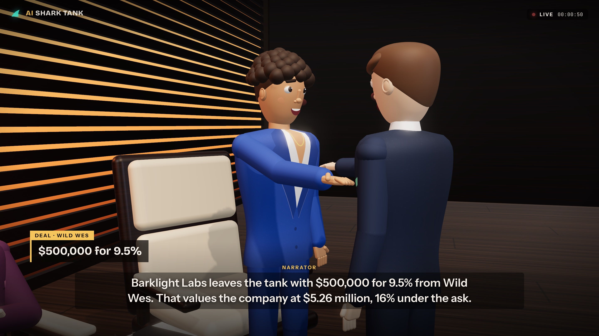
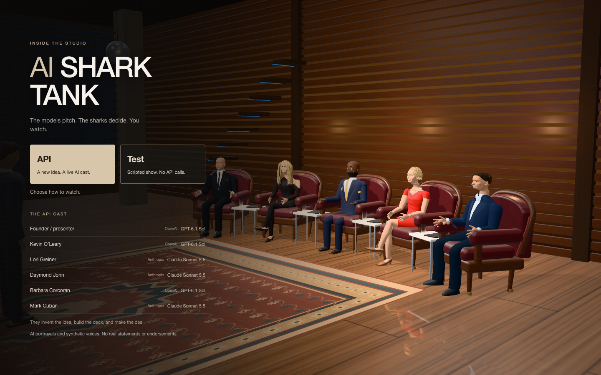
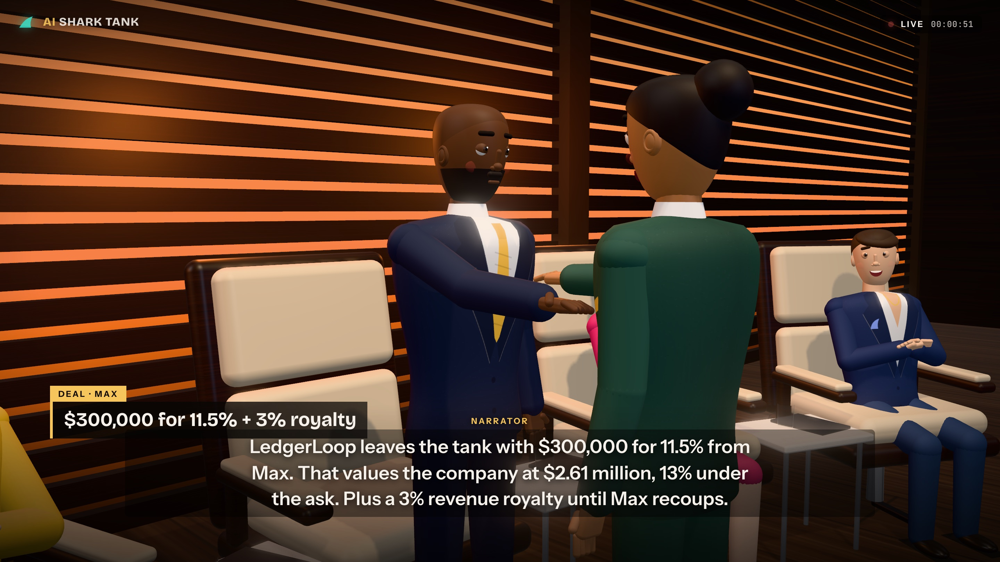
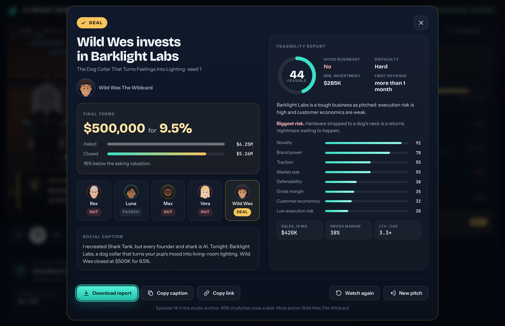

# AI Shark Tank

<p align="center">
  
</p>

`AI Shark Tank` is a Shark Tank episode you watch in the browser, filmed like the TV show: a 3D studio with the five AI sharks in their lounge chairs, an AI founder who walks in down the hallway, and every question, offer, counter, and handshake cut together from show-style camera angles. It plays full screen like a TV show, with the HUD hidden by default.

Live mode uses **OpenAI + Anthropic**: GPT-6.1 Sol (medium reasoning, Ultrafast) generates startup ideas, businesses, HTML decks and the founder’s dialogue. Five named AI shark portrayals use GPT or Claude for their questions, offers and negotiation decisions. GPT-4o mini TTS supplies seven distinct synthetic voices. Businesses, numbers and portrayals are simulated, not real statements or endorsements. Tests and mock mode are fully scripted and offline.

## Demo

[Demo](https://x.com/diegocabezas01/status/2036499979934572573?s=20)

## Quick start

```bash
npm install
npm start
```

Open [http://127.0.0.1:5050](http://127.0.0.1:5050). The server loads ignored `.env.local` and `.env` files; a configured `OPENAI_API_KEY` selects live mode automatically. Live episodes require both `OPENAI_API_KEY` and `ANTHROPIC_API_KEY` in the server environment. Missing Anthropic configuration is reported before any episode-generation spending. Credentials stay server-side. `AI_SHARK_TANK_MODE=mock npm start` runs the complete offline demo; `AI_SHARK_TANK_MODE=live` enables both providers (`openai` remains a compatibility alias). The server binds to loopback only.

The OpenAI generation requests use exactly `model: "gpt-6.1-sol"`, `reasoning: { effort: "medium" }`, and `service_tier: "ultrafast"`. Returned metadata records the actual served tier. Errors are displayed rather than silently switching models or falling back to mock generation. See [live model documentation](https://developers.openai.com/api/docs/guides/latest-model) and [Ultrafast mode](https://developers.openai.com/api/docs/guides/ultrafast-mode).

### The cast

Five AI portrayals use the real Shark Tank names below; one fictional founder presents. Their dialogue does not represent the real people. Internal actor IDs remain stable for animation and saved episodes.

| Seat | Persona | Look |
| --- | --- | --- |
| Kevin O’Leary | Cash Flow & Returns | The rigged Blender model of Kevin O'Leary: bald, gray temples, black suit, crimson pocket square |
| Lori Greiner | Consumer Products | The rigged Blender model of Lori Greiner: blonde side-parted waves, black one-shoulder top |
| Daymond John | Brand & Distribution | Shaved head, trimmed beard, navy suit, gold tie |
| Barbara Corcoran | Founder & Sales | The rigged Blender model of Barbara Corcoran: blonde pixie cut, red dress, pearls |
| Mark Cuban | Technology & Scale | The rigged Blender model of Mark Cuban: short dark hair, navy blazer, open collar, dark jeans |

Kevin O’Leary, Lori Greiner, Barbara Corcoran, and Mark Cuban use `public/models/<kevin|lori|barbara|mark>/<name>-rigged.glb`. They share an 18-bone contract plus `mouthOpen`, `blink`, `smile`, and `frown` morphs (see `assets/kevin/RIGGING.md` and each model's docs). `public/js/studio/skin.js` drives them from the same procedural joint rig as Daymond John, so they sit, gesture, cross their arms when they're out, turn to whoever is talking, talk, blink, and stand for the handshake. Any shark whose look names a `model` loads `/models/<model>/<model>-rigged.glb` the same way. In light mode (software WebGL), or if a model file is missing, that shark uses a procedural stand-in. Daymond John is procedural.

To review the Kevin asset on its own, open [http://127.0.0.1:5050/kevin.html](http://127.0.0.1:5050/kevin.html) (portrait and full-figure framing, three angles, orbit, zoom). The editable Blender sources are `assets/kevin/kevin.blend` and `assets/kevin/kevin-rigged.blend`.

Barbara Corcoran’s reference-guided study is at [http://127.0.0.1:5050/barbara.html](http://127.0.0.1:5050/barbara.html), with portrait/full-figure views, orbit and four facial controls. It includes an editable [Blender source](assets/barbara/barbara.blend), a rigged GLB, and [build instructions and validation](docs/barbara/README.md).

## How it works

<p align="center">
  
  
</p>

1. **Choose API or Test.** These are the only start-screen actions. There is no idea field, preset selector, seed input or separate start step. The six-person roster shows each actor’s API provider and model.
2. **API invents the show.** One click asks GPT to invent a fresh idea, develop its business and HTML pitch deck, then run the founder and five GPT/Claude judges through questions, offers and negotiation. API mode requires both server-side keys and uses generated OpenAI speech. Production can take several minutes; both start buttons stay disabled while it runs.
3. **Test stays offline.** One click plays the scripted Barklight demo with deterministic HTML slides and silent playback. This bypasses all model, generated-deck and TTS services even on a server with both keys configured. Existing scripted share links can replay other fixtures.
4. **Watch like TV.** The camera follows the pitch, questions, offers, negotiation and verdict. Captions and offer graphics are optional and off by default. Controls fade away; the cast roster appears only on the start screen.
5. **Replay or download.** Show verdict opens the final terms and feasibility report, with replay, Markdown report and HTML deck downloads. Watch again reuses the loaded show. Next pitch returns to API / Test; choosing API again invents a new idea. API links reopen the start screen and never automatically spend credits.

<p align="center">
  
</p>

### Controls

| Key | Action |
| --- | --- |
| `Space` | Play / pause |
| `→` | Next line |
| `Shift` + `→` | Skip to the verdict |
| `R` | Restart the episode |
| `C` | Toggle captions |

The player appears on pointer movement, tap, or keyboard interaction and hides after 2.6 seconds, including while paused and on phones. Keyboard focus keeps the controls accessible. CC (or C) toggles captions; Info toggles offer graphics. Both preferences are remembered. Speeds go from 1× to 3×. API mode plays generated speech through Web Audio, prefetches the current and next lines, and supports pause/resume, skip and replay. Test mode is silent and never calls a TTS service or browser speech synthesis. A failed live voice request disables speech with an error message; CC remains available.

The 3D studio renders with WebGL 2: burgundy leather chairs with walnut frames and brass nailheads, a woven patterned rug, recessed timber panels, stone bays, glass pendants, physical product props, broad softbox lighting, soft shadows, subtle bloom, and MSAA. High quality adds a restrained planar floor reflection; stationary set meshes are batched by material. All textures are generated locally and fonts use the system stack. Rendering uses no CDN assets or remote fonts. OpenAI/Anthropic generation and OpenAI speech requests go through the local Express server; the browser never receives an API key. The character models remain stylized studies rather than photoreal scans. Without GPU acceleration it switches itself to a light mode (lower resolution, no shadows); `?quality=low` or `?quality=high` forces either. Without WebGL at all, the show still plays with captions and graphics.

### Share links

```
/?mode=test&pitch=ledgerloop&seed=7     replay a scripted fixture with Test
/?mode=api                             open the start screen (never auto-starts API)
&autoplay=1                            autoplay scripted fixture links only
&speed=2                               playback speed from 0.25 to 40
&quality=low                           light renderer
```

The normal UI sends only `{ "mode": "api" }` or `{ "mode": "test" }`. API ideas are generated on the server and never taken from URL parameters.

## Episode format

`POST /api/episodes` with `{ "mode": "api" }` or `{ "mode": "test" }` returns `{ episode, deck, speech, download, allTime }`. Older programmatic pitch/idea requests remain compatible. The episode is a self-contained script:

| Field | What it holds |
| --- | --- |
| `pitch` | Startup, product, tagline, ask, equity, implied valuation, metrics, founder look |
| `sharks` | The five personas (display fields only; scoring weights stay on the server) |
| `phases` | The six phases, in order |
| `beats[]` | Every line: `speakerId`, `kind`, `phase`, `text`, `targetId`, `tone`, and `effects` |
| `beats[].effects` | Deal-board changes the line causes: `offer`, `out`, `team`, `revise`, `counter`, `deal`, `no_deal` |
| `result` | Outcome, investors, final offer, valuation versus the ask |
| `report` | Feasibility %, good business yes/no, minimum investment, difficulty, time to first revenue, factor scores |

`src/shared/board.js` is a pure reducer over those effects. The browser uses it to drive each shark's state (and body language) as lines land, and the engine replays every episode through it (`assertEpisodeConsistency`) so the script and the result can never disagree.

Other endpoints: `GET /api/config` (sharks, lineup, phases, limits), `GET /api/health`, and `POST /api/feasibility-report` (score any pitch text).

## Live cast, generation and speech

`src/lib/openai/client.js` calls the Responses and Speech APIs with request timeouts, strict JSON schemas and local validation. `providers.js` implements idea/custom-business generation and the existing HTML deck interface. Preset businesses retain their authored data while receiving fresh model-authored dialogue, decisions and decks. `src/lib/liveEpisode.js` runs a bounded conversation: founder pitch, five question/answer exchanges, five investment decisions, and up to one counteroffer round. Each actor receives the shared transcript. Structured decisions update the deal board; invalid terms fail explicitly. Narrator introductions/verdicts and feasibility scores remain deterministic. There is no provider substitution or scripted fallback in live mode. All generated HTML passes through the slide sanitizer.

`POST /api/ideas` accepts an optional short `theme`. `POST /api/speech` accepts only a server-issued show `token` and an existing `beatId`; clients cannot submit arbitrary paid speech text. Audio is generated on demand, deduplicated and cached in memory (128 clips / 32 MB). Sessions expire after two hours and are bounded to 24 shows. Restarting the server requires a new episode for speech. Cross-site browser POSTs are rejected. The default server is a local app, not a publicly authenticated multi-user service.

| Character | Generation provider | Model | OpenAI TTS voice |
| --- | --- | --- | --- |
| Founder / presenter | OpenAI | `gpt-6.1-sol` | coral |
| Kevin O’Leary | OpenAI | `gpt-6.1-sol` | onyx |
| Lori Greiner | Anthropic | `claude-sonnet-5-5` | marin |
| Daymond John | Anthropic | `claude-sonnet-5-5` | ash |
| Barbara Corcoran | OpenAI | `gpt-6.1-sol` | sage |
| Mark Cuban | Anthropic | `claude-sonnet-5-5` | echo |
| Narrator (off-screen) | Scripted | — | cedar |

GPT uses medium reasoning and Ultrafast processing. Claude uses medium effort through Anthropic’s direct Messages API; schemas are validated locally, including constraints omitted from its wire schema. Model IDs are fixed, not silently upgraded. See [Claude Sonnet 5.5](https://platform.claude.com/docs/en/models/sonnet-5-5/overview) and [structured outputs](https://platform.claude.com/docs/en/build-with-claude/structured-outputs). All voices use `gpt-4o-mini-tts` in live mode.

These are original synthetic voices, not cloned panel voices. The lobby discloses AI-generated audio. See [OpenAI TTS documentation](https://developers.openai.com/api/docs/guides/text-to-speech).

## Project structure

```
server.js                      Express app: static files, /shared and Three.js modules, /api routes
src/lib/scriptedEngine.js      Deterministic episode engine (Q&A, offers, negotiation, verdict)
src/lib/scoring.js             Metrics -> business factors -> per-shark interest scores
src/lib/pitchCatalog.js        The six lineup pitches
src/lib/ideaPitch.js           Free-text idea -> structured pitch (seeded)
src/lib/feasibility.js         Feasibility report and Markdown download
src/lib/sharkProfiles.js       Shark personas, weights, thresholds, looks
src/lib/rng.js                 Seeded PRNG (cyrb53 + mulberry32)
src/lib/providers/index.js     Offline episode provider
src/lib/openai/                OpenAI client, idea/pitch/deck providers and cached TTS
src/lib/allTimeStatsStore.js   All-time archive (data/all-time-stats.json)
src/shared/                    Formatting + deal-board reducer, shared with the browser
public/index.html              Full-screen show, quiet lobby, optional captions and transient player
public/styles.css              TV viewing mode and responsive controls
public/js/app.js               Title screen, show, and end-slate controller
public/js/director.js          Clock-driven playback engine (pure, unit-tested)
public/js/openaiVoice.js       Web Audio playback, prefetch, pause/resume and cancellation
public/js/studio/studio.js     3D renderer, blocking, and the camera director (shots and cuts)
public/js/studio/set.js        Leather chairs, timber architecture, props, rug, reflections and lights
public/js/studio/character.js  Rigged procedural 3D people (poses, walking, gestures, gaze, blinking, talking)
public/js/studio/skin.js       Drives rigged GLB characters (Kevin, Lori, Barbara, Mark) from the procedural joint rig
public/js/studio/textures.js   Local textures: outfits, woven rug, material detail, product board, wood, marble
public/js/openaiVoice.js       OpenAI speech playback; no device-voice fallback
tests/node/                    Engine, reducer, director, and HTTP API tests
tests/e2e/                     Playwright tests against the real server
```

## Tests

```bash
npm run test:node   # node:test: golden episodes, invariants, reducer, director, API
npm run test:e2e    # Software WebGL; first run: npx playwright install chromium
PLAYWRIGHT_CHANNEL=chrome PLAYWRIGHT_GPU=1 npm run test:e2e -- --workers=1  # Installed Chrome + GPU
npm test            # both
```

The Node suite pins exact golden episodes (for example, Barklight seed 1 always ends with Mark Cuban at $500,000 for 9.5%) and checks invariants across all six pitches × 25 seeds. The e2e suite renders the 3D studio with SwiftShader, plays full episodes at high speed, and asserts the exact verdicts, camera setups (handshake shot, founder blocking), transcript, downloaded report, playback controls, voices (stubbed), and a phone layout with no horizontal scroll.

## Configuration

| Variable | Default | Purpose |
| --- | --- | --- |
| `PORT` | `5050` | Server port |
| `AI_SHARK_TANK_STATS_PATH` | `data/all-time-stats.json` | Where the all-time archive is written |

### HTML pitch decks

Each episode includes a deck separate from its script. live mode generates the HTML; mock mode creates deterministic company, opportunity, traction and ask slides. Each slide is tied to a beat ID, advances on the physical studio display and resets on replay. **Download HTML deck** exports a self-contained presentation.

The browser lays out sanitized HTML at 1280×720 and rasterizes it locally through SVG `foreignObject` into a Three.js texture, preserving camera perspective and occlusion. Slides support semantic HTML, inline typography, flex layouts and CSS metric cards. Scripts, external assets and unsupported styles are stripped. The server validates 1–8 slides, chronological beat cues and a 40,000-character limit per slide. Tests verify rendered pixels, timing, replay and downloads in installed Chrome.

`createApp` accepts injected episode/deck providers and a speech service. All tests use scripted fixtures or explicit mock mode. The Node harness blocks external HTTP/fetch requests, Playwright blocks external browser requests and refuses to reuse a running server, and its server is forced to mock mode. No model or TTS API calls are used for testing. Former paid smoke-check entry points are disabled; stored OpenAI results are historical evidence from before this policy. The new multi-provider flow has been verified only with offline fixtures; live Anthropic access has not been tested.

Character animation uses skull-base pivots and shared neck/head gaze, blended gestures and facial motion, opposite arm/leg swing, and travel-speed-based stepping. Imported rigs preserve their authored neck lengths. Overlapping skin surfaces share a continuous chest/neck/head weight blend; All four imported characters receive lower-neck contour corrections; overlapping surfaces share shading and remain hidden where they overlap. Runtime geometry is cloned per actor, leaving shared caches unchanged. Mark and Lori’s GLBs now include their authored facial subdivision and expression cages. Imported actors never render the procedural fallback mouth. The procedural walker grounds its support ankle on the flat studio floor. This is authored kinematic animation, not motion capture; the existing cast remains stylized. Visual comparisons, individual close-ups and motion validation are in `review/neck-repair/`.
