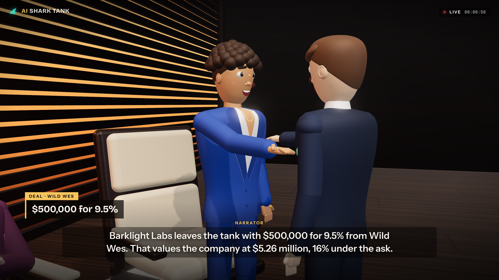
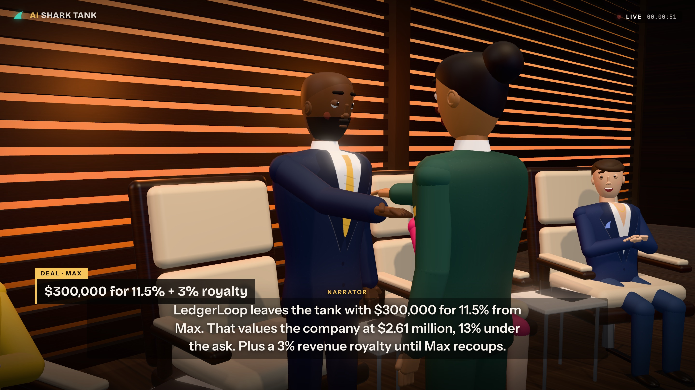

# AI Shark Tank

<p align="center">
  
</p>

`AI Shark Tank` is a Shark Tank episode you watch in the browser, filmed like the TV show: a 3D studio with the five AI sharks in their lounge chairs, an AI founder who walks in down the hallway, and every question, offer, counter, and handshake cut together from show-style camera angles. There's no dashboard. It plays full screen with TV graphics, made for screenshots, short videos, and social-ready demos.

Right now every episode comes from a **deterministic scripted engine**. There are no API keys and no model calls. The same pitch and seed always produce the same episode, so you can test, record, and share exact takes. A live model provider can plug in later without touching the UI (see [Connecting a live model later](#connecting-a-live-model-later)).

## Demo

[Demo](https://x.com/diegocabezas01/status/2036499979934572573?s=20)

## Quick start

```bash
npm install
npm start
```

Open [http://127.0.0.1:5050](http://127.0.0.1:5050). No `.env` is needed.

### The cast

The sharks' looks nod to the real panel, but their on-air names stay fictional because every line they say is generated:

| Seat | Persona | Look |
| --- | --- | --- |
| Rex | The Skeptic | The rigged Blender model of Kevin O'Leary: bald, gray temples, black suit, crimson pocket square |
| Luna | The Visionary | The rigged Blender model of Lori Greiner: blonde side-parted waves, black one-shoulder top |
| Max | The Numbers Shark | Shaved head, trimmed beard, navy suit, gold tie |
| Vera | The Brand Guru | Short full blonde hair, hot-pink blazer, pearls |
| Wild Wes | The Wildcard | Short dark hair, navy blazer, open collar, jeans |

Rex uses `public/models/kevin/kevin-rigged.glb` and Luna uses `public/models/lori/lori-rigged.glb`. Both share an 18-bone contract plus `mouthOpen`, `blink`, `smile`, and `frown` morphs (see `assets/kevin/RIGGING.md` and `docs/lori/README.md`). `public/js/studio/skin.js` drives them from the same procedural joint rig as the rest of the cast, so they sit, gesture, cross their arms when they're out, turn to whoever is talking, talk, blink, and stand for the handshake. Any shark whose look names a `model` loads `/models/<model>/<model>-rigged.glb` the same way. In light mode (software WebGL), they use procedural stand-ins. The other three are procedural.

To review the Kevin asset on its own, open [http://127.0.0.1:5050/kevin.html](http://127.0.0.1:5050/kevin.html) (portrait and full-figure framing, three angles, orbit, zoom). The editable Blender sources are `assets/kevin/kevin.blend` and `assets/kevin/kevin-rigged.blend`.

## How it works

<p align="center">
  
  
</p>

1. **Pick a founder.** Six hand-written pitches (pet hardware, food-truck SaaS, frozen dumplings, a sassy plant sensor, ocean-plastic buoys, a mismatched-sock club), or type your own idea and the engine builds a company around it.
2. **Pick a seed.** Same pitch + seed = same episode. A different seed is an alternate take: different questions, a different shark mood, sometimes a different deal.
3. **Enter the tank.** The show runs through six phases:
   - **Cold open** and the founder's entrance
   - **Pitch**: the ask, the problem, the product, the proof
   - **Q&A**: each shark asks one question, aimed at the weakest metric they care about
   - **Offers**: each shark scores the pitch on eight business factors (traction, margin, customer economics, defensibility, novelty, market size, brand, execution risk) through their own persona weights. Above their threshold they make an offer, and the less excited they are, the more equity they want. The least interested go out first.
   - **Negotiation**: with several offers the founder either starts a bidding war or asks two sharks to team up. Then the founder counters, and the shark accepts, meets in the middle, or holds firm. The founder walks if the terms pass their walk-away point.
   - **Verdict**: deal or no deal, plus a feasibility report
4. **Watch it like TV.** The camera cuts between the show's setups: an establishing wide of the set, the founder's entrance down the blue hallway, close-ups on whoever is talking, over-the-shoulder reverse shots from behind the sharks, and a medium shot as each shark decides. Sharks lean in when they make an offer and sit back with their arms crossed when they go out. On a deal, the shark stands up and shakes the founder's hand; on a no-deal, the founder walks back out. Captions run at the bottom, and offers, counters, and the final terms come up as lower-thirds.
5. **Take it with you.** The end slate shows the result and the feasibility headline. From there you can watch again, download the full feasibility report as Markdown (with the transcript), or copy a share link or social caption.

<p align="center">
  
</p>

### Controls

| Key | Action |
| --- | --- |
| `Space` | Play / pause |
| `→` | Next line |
| `Shift` + `→` | Skip to the verdict |
| `R` | Restart the episode |

The player bar fades in when you move the mouse or pause. Speeds go from 1× to 3×. The voice toggle reads lines aloud with your browser's built-in speech synthesis, so it still makes no network calls.

The 3D studio renders with WebGL 2 (bloom, soft shadows, and MSAA on a GPU). Without GPU acceleration it switches itself to a light mode (lower resolution, no shadows); `?quality=low` or `?quality=high` forces either. Without WebGL at all, the show still plays with captions and graphics.

### Share links

```
/?pitch=ledgerloop&seed=7               preselect a pitch and seed
/?idea=a+robot+that+folds+laundry       preselect a custom idea
&autoplay=1                             start immediately
&speed=2                                any playback speed from 0.25 to 40
&quality=low                            force the light renderer
```

## Episode format

`POST /api/episodes` with `{ "pitchId": "barklight", "seed": 1 }` (or `{ "idea": "...", "seed": 1 }`) returns `{ episode, download, allTime }`. The episode is a self-contained script:

| Field | What it holds |
| --- | --- |
| `pitch` | Startup, product, tagline, ask, equity, implied valuation, metrics, founder look |
| `sharks` | The five personas (display fields only; scoring weights stay on the server) |
| `phases` | The six phases, in order |
| `beats[]` | Every line: `speakerId`, `kind`, `phase`, `text`, `targetId`, `tone`, and `effects` |
| `beats[].effects` | Deal-board changes the line causes: `offer`, `out`, `team`, `revise`, `counter`, `deal`, `no_deal` |
| `result` | Outcome, investors, final offer, valuation versus the ask |
| `report` | Feasibility %, good business yes/no, minimum investment, difficulty, time to first revenue, factor scores |

`src/shared/board.js` is a pure reducer over those effects. The browser uses it to drive each shark's state (and body language) as lines land, and the engine replays every episode through it (`assertEpisodeConsistency`) so the script and the result can never disagree.

Other endpoints: `GET /api/config` (sharks, lineup, phases, limits), `GET /api/health`, and `POST /api/feasibility-report` (score any pitch text).

## Connecting a live model later

All episode generation goes through `src/lib/providers/index.js`. To add a model-backed provider:

1. Implement `{ id, label, live: true, async createEpisode({ pitchId, idea, seed }) }` and return the same episode shape.
2. Run the result through `assertEpisodeConsistency` so its effects add up to its result.
3. Select it in `getEpisodeProvider()`, for example from an environment variable, and put the key in a local `.env` that stays out of git.

The studio, graphics, end slate, and report work unchanged. The original OpenAI Agents SDK engine is in git history (commit `a75b7a5`) if you want to reuse any of it.

## Project structure

```
server.js                      Express app: static files, /shared and Three.js modules, /api routes
src/lib/scriptedEngine.js      Deterministic episode engine (Q&A, offers, negotiation, verdict)
src/lib/scoring.js             Metrics -> business factors -> per-shark interest scores
src/lib/pitchCatalog.js        The six lineup pitches
src/lib/ideaPitch.js           Free-text idea -> structured pitch (seeded)
src/lib/feasibility.js         Feasibility report and Markdown download
src/lib/sharkProfiles.js       Shark personas, weights, thresholds, looks
src/lib/rng.js                 Seeded PRNG (cyrb53 + mulberry32)
src/lib/providers/index.js     Episode provider seam
src/lib/allTimeStatsStore.js   All-time archive (data/all-time-stats.json)
src/shared/                    Formatting + deal-board reducer, shared with the browser
public/index.html              Full-screen broadcast shell (title screen, TV graphics, player bar)
public/styles.css              Broadcast styling
public/js/app.js               Title screen, show, and end-slate controller
public/js/director.js          Clock-driven playback engine (pure, unit-tested)
public/js/studio/studio.js     3D renderer, blocking, and the camera director (shots and cuts)
public/js/studio/set.js        The set: slat wall, stairs, lounge chairs, side tables, rug, hallway, lights
public/js/studio/character.js  Rigged procedural 3D people (poses, walking, gestures, gaze, blinking, talking)
public/js/studio/skin.js       Drives rigged GLB characters (Kevin, Lori) from the procedural joint rig
public/js/studio/textures.js   Painted textures: outfits, rug, product board, sign, wood, marble
public/js/voice.js             Optional browser speech synthesis
tests/node/                    Engine, reducer, director, and HTTP API tests
tests/e2e/                     Playwright tests against the real server
```

## Tests

```bash
npm run test:node   # node:test: golden episodes, invariants, reducer, director, API
npm run test:e2e    # Playwright against the real server with software WebGL (first run: npx playwright install chromium)
npm test            # both
```

The Node suite pins exact golden episodes (for example, Barklight seed 1 always ends with Wild Wes at $500,000 for 9.5%) and checks invariants across all six pitches × 25 seeds. The e2e suite renders the 3D studio with SwiftShader, plays full episodes at high speed, and asserts the exact verdicts, camera setups (handshake shot, founder blocking), transcript, downloaded report, playback controls, voices (stubbed), and a phone layout with no horizontal scroll.

## Configuration

| Variable | Default | Purpose |
| --- | --- | --- |
| `PORT` | `5050` | Server port |
| `AI_SHARK_TANK_STATS_PATH` | `data/all-time-stats.json` | Where the all-time archive is written |
