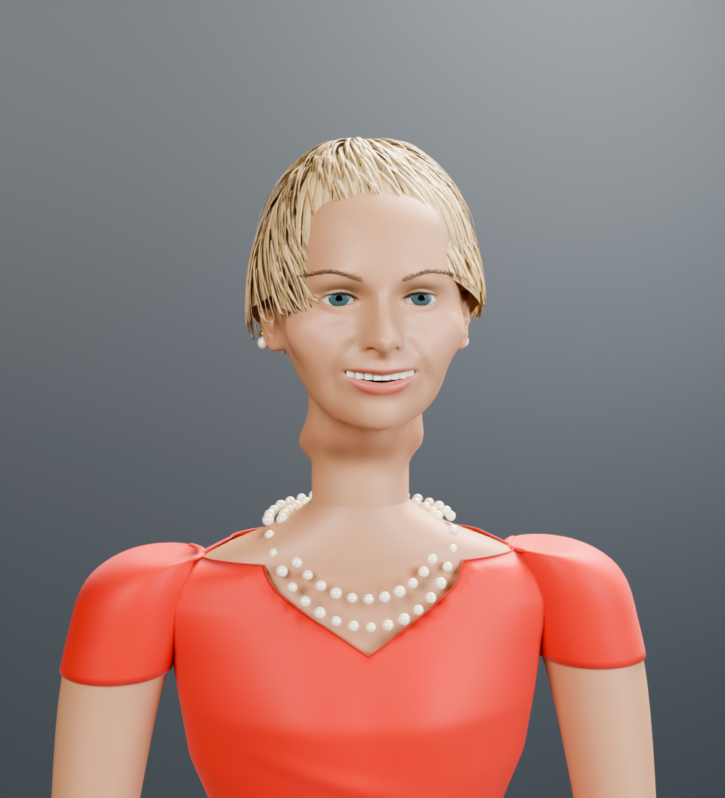

# Barbara Corcoran — Blender character study

An editable, stylized likeness guided by the supplied reference: cropped blonde pixie, blue-green eyes, red V-neck wrap dress, two pearl strands, pearl earrings and a gold bracelet. The model has a distinct reshaped face, anatomical hands and a standing bind pose. It is available at `/barbara.html`; the episode cast is unchanged.



## Assets and review

- `assets/barbara/barbara.blend`: editable meshes, named materials, 18-bone armature, facial shapes and lit portrait camera.
- `public/models/barbara/barbara-rigged.glb`: self-contained glTF 2.0 runtime model, under 12 MB.
- `/barbara.html`: orbit/zoom, portrait and full figure, front/three-quarter/profile, auto-rotate, reset, and neutral/smile/frown/blink/mouth-open controls. Failed downloads can be retried.
- `portrait.png`, `standing.png`, `seated.png`: Blender Cycles renders.
- `runtime-portrait.png`: the shipped GLB re-imported and rendered in Blender.
- `browser-portrait.png`, `browser-mobile.png`: real GLB rendered in Chrome at desktop and 390px mobile widths.

## Rebuild

Blender 5.2.1 LTS was used, both through the local Blender MCP and offline Python builders. The build needs no network access. Run from the repository root:

```sh
blender --background --python scripts/build_barbara.py -- --render
blender --background --python scripts/verify_barbara.py -- --render
npm ci
npm run check
npm run test:node
npx playwright install chromium
npx playwright test tests/e2e/barbara-viewer.spec.mjs tests/e2e/kevin-viewer.spec.mjs
npm start
# Open http://127.0.0.1:5050/barbara.html
```

The builder uses the existing Lori CC0 anatomy and shared helpers without editing those assets. It creates a separate scene, exports only the selected character in that scene, saves the standing source, then applies an explicit seated QA pose. Re-running produces Blender backup files, ignored by Git.

## Rig and verification

Metres; Blender Z-up/-Y-forward, glTF Y-up/+Z-forward; anatomical left is +X. The skeleton follows the existing 18-bone contract: pelvis, spine, chest, neck, head, jaw, and upperarm/forearm/hand/thigh/shin/foot on both sides. No animation is baked into the GLB. `mouthOpen`, `blink`, `smile` and `frown` start at zero; keep the jaw neutral when using mouthOpen.

`rig-validation.json` records normalized weights with at most four influences and stable bodice weighting. `runtime-validation.json` records GLB re-import and a 30-degree head-turn check. Node tests parse the real GLB, check skeleton hierarchy, axes, finite normalized weights, neutral defaults and nonempty facial deformations, and rotate the head to check actual hair deformation. Browser tests load the real GLB, exercise all controls, retry a failed download and check narrow layout. Existing Kevin viewer tests also run.

The local test run used installed Chrome because the pinned Playwright Chromium was absent. All 67 Node tests and four targeted browser tests passed. Chrome completed all four test cases but the runner stalled during teardown; its identified test server and runner were stopped manually. No app development server is left running.

## Limits

This is a stylized anatomical study, not a photoreal digital double. Hair uses solid sculpted locks, not a strand simulation. The dress uses skin weights, not cloth physics; the included seated pose is checked, but crossed legs and extreme gestures need further tailoring. Fingers are modeled but have no individual bones. Four facial shapes are available, not a full performance rig. Procedural skin/fabric micro-bump is Blender-only; portable colors, facial vertex pigment and PBR materials are exported. No photograph or third-party reference image is bundled. [Asset provenance](../../assets/barbara/PROVENANCE.md).
