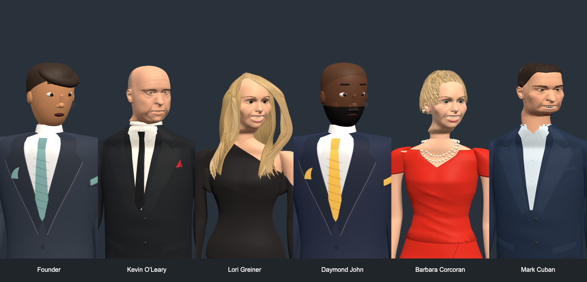
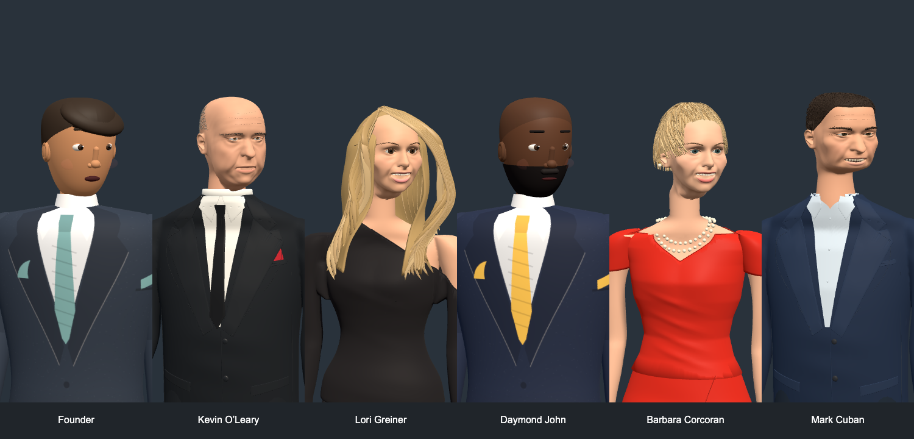

# Neck repair validation

Validated on 2026-11-11 using scripted responses only. No model or TTS API calls were made.

- `npm run test:node`: all 102 tests passed with the offline network guard.
- `E2E_PORT=5058 PLAYWRIGHT_CHANNEL=chrome PLAYWRIGHT_GPU=1 npm run test:e2e -- --workers=1 --trace=off`: 27 distinct browser cases passed across the full run and the focused playback/voice rerun after the hidden-control CSS fix.
- Reviewed neutral, speaking/head-turn and four walking/seated frame captures for all six characters, plus front/quarter/profile close-ups of each imported character.
- Reimported Mark and Lori’s updated GLBs into Blender and checked their skeletons and expressions.
- Regression covers hidden fallback meshes during speaking, so the duplicate mouth cannot reappear on an imported character.
- Mocked OpenAI audio success and failure; Test mode uses mocked local browser voices even when API mode is available, with no speech endpoint calls.

The seam regression samples overlapping neck surfaces while standing, sitting and leaning, looking left and right with speech enabled:

| Character | Paired samples | Maximum separation | Maximum drift from rest | Face/chin position changes | Cached source changes |
| --- | ---: | ---: | ---: | ---: | --- |
| Lori | 13 | 2.55 mm | 0.16 mm | 0 | None |
| Barbara | 176 | 2.71 mm | 0.25 mm | 0 | None |

All sampled weights were finite, nonnegative and normalized. These are sampled geometric checks, not a guarantee for every possible pose. The existing cast remains stylized; the stock scan pack was used only for reference inspection.

## Visual comparison

Before: 

After: 

For recapture instructions and reference provenance, see [the repair notes](../../docs/characters/neck-repair.md).

The founder and Daymond remain procedural placeholders. Hair, cloth and skin still need an asset-quality pass to meet the requested realistic visual style; these test results do not certify photorealism.
